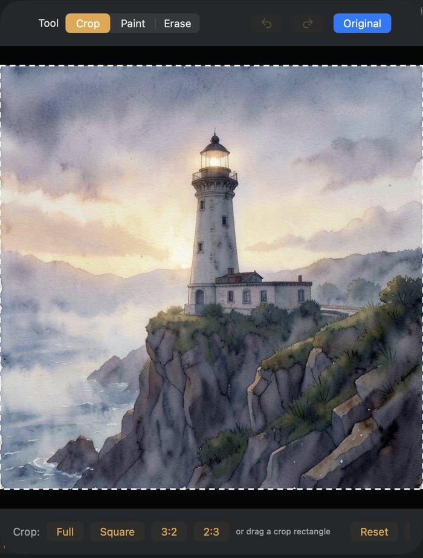

# dMLX

Create and edit images by chatting, fully on your Mac. A native macOS app and a local engine built on
[MLX](https://github.com/ml-explore/mlx) and [mflux](https://github.com/filipstrand/mflux), with a small
on-device agent that plans every message.

**Built to keep your Mac usable while it works.** Every image job is checked against free memory first, and stopped before macOS starts swapping. Tested on a 24 GB Mac and on a simulated 16 GB Mac ([how](tasks/10-16gb-without-a-16gb-mac.md)).

> **Status: v0.1 beta 2.** Images only (generate and edit); video is planned. Not notarized yet.
> See [release notes](docs/RELEASE_NOTES.md) and [known issues](docs/KNOWN_ISSUES.md).

<p align="center">
  
</p>

## Highlights

- **Chat to create and edit.** Describe an image, then change it in plain words ("make the boat red").
  Every image gets a number, so you can say "image 1" or "the first one".
- **An agent plans every message.** A vision-language model on your Mac reads the chat, looks at the
  images and decides: a new image or an edit, which image to change, which to use as references, and
  which image model fits.
- **It talks back in the chat.** Unclear messages get one short question; greetings and questions about
  the app get a reply instead of an image.
- **Keeps your Mac usable.** Memory is checked before every image job, models load in pieces when it is
  tight, and a job stops before macOS starts to swap. Made for 16 GB and up.
- **Versions, not overwrites.** Variations stack as v1, v2, v3; edit any version; edit your prompt and
  rerun.
- **Private and offline.** Everything runs locally once the models are downloaded. No account, no cloud.
- **A local API.** The engine speaks an OpenAI-compatible images API for other apps and agents.

## A tour

Every screenshot is from the app running on a 24 GB Mac with Qwen3-VL 8B as the agent.

| **The agent asks when it is unsure.** "make them match" with two images in the chat gets a question, not a guess. Answer it, use the shortcuts, or ask for something else. | **Then it uses both images.** "give the teapot the same weathered wood as the boat" edits the teapot with the boat as a reference ("Edited from image 2 · + 1 reference"). |
|---|---|
|  |  |
| **It finds older images.** The teapot is the latest image; "make the boat red" edits the boat in image 1. The agent looks at older images when the message points to them. | **It replies to small talk.** A greeting or a thank-you gets a reply in the chat, not an image. |
|  |  |
| **Your own pictures.** Attach up to 3 files (paper clip or drag and drop). "a lighthouse on a cliff at dusk, painted like this" uses the attached watercolor as the style. | **Crop / Draw.** Crop a result, or paint and erase on it; the copy is attached to your next message and the original is kept. |
| <br> |  |
| **Auto picks the model, and memory is checked first.** For a title in the image the agent picked Qwen Image 2.1 (best at words). It needed 9.5 GB and 9.2 GB was free, so the job was refused instead of slowing the Mac; **Try anyway** runs it in the lowest-memory mode. | **Never lost while it plans.** A sent message shows with "Planning…" while the agent decides; you can keep typing. |
|  |  |
| **Add models.** Search the community versions of the supported families, or paste any Hugging Face repo; dMLX checks it before downloading. | **Manage models.** See what is installed, remove models, and set the default (Auto lets the agent choose). |
|  |  |

## The planning agent

Every message you send is planned by the agent. It:

- **decides what you asked for**: a new image, an edit, or no image at all (it replies instead);
- **finds the right image**: it sees the latest image, and can *look* at older ones or *read* further back
  in the chat when your message points there ("the boat", "the one with the cat", "undo the hat");
- **writes the prompt**: a full description for a new image, or a standalone instruction for an edit,
  optionally expanded into a detailed description of the result, which edit models follow better;
- **picks the image model** when the menu is on **Auto**, by what the message needs (exact words in the
  image, several references) and the memory that is free. A model you pick yourself is never overridden.

When it is unsure it asks one short question; answer it, or just ask for something else. A sent message
shows in the chat with **Planning…** and is never dropped; you can keep typing.

The agent's decisions come from its instructions and tools, not fixed rules in code. The code only
refuses what cannot run (an image that does not exist, an edit with no image).

<p align="center">
  
  <br><sub>Settings → Intelligence → Agent</sub>
</p>

| Agent model | Download | Peak memory | Per message | Real-image checks | Notes |
|---|---|---|---|---|---|
| Qwen3-VL 8B | 5.8 GB | 6.2 GB | ~7 s | 10/10 | Default from 24 GB |
| Qwen3.5 9B | 6.0 GB | 6.8 GB | ~7.5 s | 9/10 | Best on the routing eval |
| Ministral 3 3B | 2.8 GB | 4.2 GB | ~5.5 s | 10/10 | Default under 24 GB |
| Qwen3-VL 4B | 3.1 GB | 3.7 GB | ~3.5 s | 6/10 | Least memory; rarely looks at older images |

Measured on an M5 with 24 GB (2026-11-01). The agent is loaded only while it plans and is freed before the
image job starts. Without an agent model, messages are routed by simple rules. Details:
[`docs/benchmarks/agent-models.md`](docs/benchmarks/agent-models.md) and [`tasks/`](tasks/).

## Requirements

- Apple Silicon Mac (M1 or newer), macOS 15 or later
- 16 GB memory or more
- Disk: ~5 GB for the default image model, plus 2.8–6.0 GB for an agent model

## Install

1. Download `dMLX-<version>-macos-arm64.zip` from [Releases](https://github.com/rootonchair/dmlx/releases) and unzip it.
2. Move `dMLX.app` to Applications.
3. The beta is not notarized: the first time, **right-click the app → Open → Open**
   (or run `xattr -dr com.apple.quarantine /Applications/dMLX.app`).
4. On first launch dMLX offers to download an image model. Pick an agent model in
   **Settings → Intelligence → Agent**. After that it works offline.

## Using it

- **Make an image:** describe it. **Change it:** say what to change. **Start over:** describe something new.
- **Older images:** name them ("make image 1 black and white", "put the teapot from the first one in the boat").
- **Your own pictures:** attach up to 3 from your Mac with the paper clip, or drop them on the message box.
- **Variations** adds v2, v3… to a result; **Crop / Draw** crops or paints over a result and attaches the
  copy; the save button writes the image to Pictures/dMLX with its prompt and seed.
- **Edit Prompt…** on one of your messages reruns its image with the new words.
- While an image is being made, the send button becomes **Stop**; write your next message meanwhile.

## Image models

| Model | Does | License | Download | Notes |
|---|---|---|---|---|
| FLUX.2 Klein 4B (4-bit) | generate, edit, up to 3 images | Apache-2.0 | 4.6 GB | The default; ~20–40 s per image |
| Z-Image Turbo (4-bit) | generate | Apache-2.0 | 5.9 GB | Optional; more photographic detail |
| Qwen Image 2.1 Base (4-bit) | generate, edit, up to 10 ordered images | Qwen Research License (non-commercial) | ~10.6 GB | Experimental; best at exact words in the image; ~4 min per image and ~9.5 GB free |

**Settings → Models → Add Model…** lists community versions of the supported families (FLUX.2 Klein
4B/9B, Z-Image Turbo/base, Qwen Image 2.1 Base) and accepts any Hugging Face repo in mflux format. dMLX
checks the repo (family, size, license) before downloading and asks you to accept restricted licenses.
**Remove…** deletes a model's files. Weights go to the standard Hugging Face cache
(`~/.cache/huggingface`) and are never bundled. In Auto, Qwen Image 2.1 is used only when the agent picks
it for a message.

## How memory is handled

Before each job the engine compares what the job needs with memory it can use *without* making macOS
compress or swap other apps, keeping a reserve for the system, and picks a strategy:

| Strategy | When | What stays loaded |
|---|---|---|
| eager | plenty of room | everything, kept warm for follow-ups |
| phase-free | some room | image model and decoder; the text encoder is freed after reading the prompt |
| sequential | tight | one large part at a time |
| streamed | very tight | one block at a time, read from disk just before it runs (~25% slower; a 1024² image in ~1.5 GB) |

Below 32 GB, FLUX.2 Klein decodes in exact bands (about 1.1 GB at 1024² instead of 8.6 GB). If nothing
fits, the job is refused with a plain message; **Try anyway** runs it in the lowest-memory mode. While a
job runs, the engine watches memory pressure and swap-ins and stops the job before the Mac starts to
hang. The agent is freed before every image job, and the engine waits for its memory to come back.
Details: [`dmlx-spec.md`](dmlx-spec.md) §8, [`docs/benchmarks/b1.md`](docs/benchmarks/b1.md),
[`b2.md`](docs/benchmarks/b2.md) and [`agent-16gb.md`](docs/benchmarks/agent-16gb.md).

## Build from source

```bash
# engine (Python 3.13, uv)
cd engine && uv sync --extra local-llm && uv run pytest

# app (Swift 6 toolchain / Xcode 16+)
cd app && swift test
tools/dev/run_app.sh            # runs the app; the engine starts from ../engine via uv

# release bundle (relocatable Python and engine inside the .app, ad-hoc signed)
tools/bundle_app.sh --zip
```

Score the agent (routing eval with placeholder images):

```bash
cd engine && uv run --extra local-llm python -m dmlx.prompting.agent_eval --model qwen3-vl-8b-instruct-4bit
```

## Engine API

Run the engine on its own:

```bash
cd engine && uv run dmlx serve --port 8642
curl -s localhost:8642/v1/images/generations -H 'content-type: application/json' \
  -d '{"prompt":"a rowboat on a lake at dawn","size":"1024x1024"}' | jq '.dmlx'
```

| Method | Path | Notes |
|---|---|---|
| POST | `/v1/images/generations` | OpenAI-compatible; `stream: true` returns server-sent events |
| POST | `/v1/images/edits` | multipart (OpenAI style) or JSON with `source_id` / `reference_ids` |
| POST | `/v1/workflows` | validated, capability-aware workflow; supports streaming |
| POST | `/v1/workflows/route` | what to do with a chat message; `"plan": true` asks the agent |
| GET | `/v1/capabilities` | operations and input limits of each model |
| POST | `/v1/prompts/compile` | prompt enhancement preview |
| POST | `/v1/uploads` | store an image, get an id to reference later |
| GET | `/v1/results/{id}` · `/meta` | PNG with prompt and seed embedded · its metadata |
| GET/DELETE | `/v1/jobs/{id}` · `/events` | status · cancel · events |
| POST | `/v1/jobs/{id}/retry` | retry a failed workflow from its failed step |
| GET | `/v1/models` | catalog with downloaded / loaded state |
| POST | `/admin/models/{id}/pull` · `load` · `unload` | download, pin, free |
| GET | `/admin/memory` | memory budget, pressure, loaded parts |
| GET/POST | `/admin/prompt-assistant` · `/select` · `/pull` | agent models: status, choose, download |

Events: `queued`, `plan`, `loading{component}`, `encoding`, `step{step,total}`, `decoding`,
`image{result_id}`, `done{result_ids, report}`, `error{code,message}`, `cancelled`.

### Configuration

The app sets these in **Settings → Intelligence**; for engine-only use, set environment variables.

| Variable | Use |
|---|---|
| `DMLX_PROMPT_ASSISTANT_MODEL` | Agent model id (e.g. `ministral-3-3b-instruct-2512-4bit`) |
| `DMLX_PROMPT_ASSISTANT=off` | Turn the agent off |
| `DMLX_ROUTER_BASE_URL`, `DMLX_ROUTER_MODEL`, `DMLX_ROUTER_API_KEY`, `DMLX_ROUTER_TIMEOUT` | Routing without the agent through any OpenAI-compatible chat server (HTTPS, or HTTP on loopback) |
| `DMLX_ROUTER_PROVIDER=local-llm`, `DMLX_LOCAL_LLM_MODEL_PATH`, `DMLX_LOCAL_LLM_REVISION` | Routing without the agent through a local Qwen checkpoint ("Local Qwen MLX" in the app) |
| `DMLX_PROMPT_BASE_URL`, `DMLX_PROMPT_MODEL`, `DMLX_PROMPT_API_KEY`, `DMLX_PROMPT_TIMEOUT` | Prompt enhancement through an OpenAI-compatible server |

API keys set in the app are kept in the macOS Keychain. When the agent plans, its answer is still checked
(the images it names must exist, an edit takes 1–3 images, only workflows an installed model can run);
if it is unusable after one retry, the user is asked instead of guessing.

## Project layout

```
engine/   Python engine (FastAPI + MLX via mflux), the planning agent, evals, tests
app/      SwiftUI app (DMLXKit library + app target), tests
tools/    bundle_app.sh (release), dev/ helpers (run_app.sh, the scripted dev harness)
docs/     release notes, known issues, benchmarks, screenshots
tasks/    open and finished agent tasks, with their results
```

## License

Apache-2.0 for all code in this repository. Model weights have their own licenses: the defaults are
Apache-2.0; the optional Qwen Image 2.1 uses the Qwen Research License (non-commercial).
