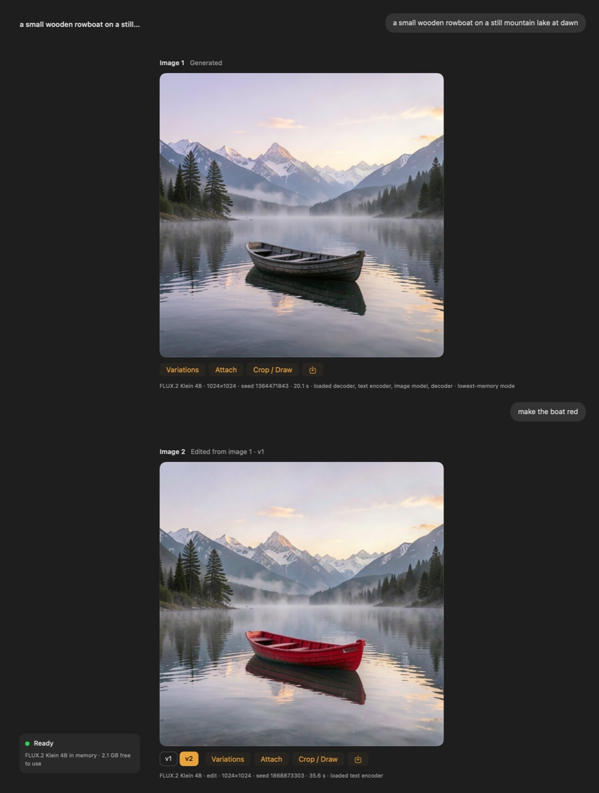

# dMLX

Create and edit images by chatting, fully on your Mac. dMLX is a native macOS app plus a local engine built on [MLX](https://github.com/ml-explore/mlx) and [mflux](https://github.com/filipstrand/mflux). Its main promise: **it never makes your Mac hang**, even on a 16 GB machine.

> Status: **v0.1 beta**. Images only (generate + edit). Video is planned, not included. See [known issues](docs/KNOWN_ISSUES.md).

<p align="center">
  
</p>

## What it does

- **Chat to create.** Describe an image; follow up in plain words ("make the boat red") to change it. Each image in a chat gets a number ("Image 2 · Edited from image 1"), and you can refer to it that way ("image 1", "the first one").
- **A planning agent reads every message.** A small vision-language model, run on your Mac, reads the chat and looks at the images, then decides what the message asks for: a new image or an edit, and which earlier images to edit or use as references. It can look at older images in the chat and read further back when a message depends on them. For an edit it can also write a detailed description of the result, which the image model follows better than a short command. When it cannot tell what you mean, it asks one short question and you answer in the chat; a message that is not a request for an image (a greeting, a question) gets a short reply instead of an image.
- **Auto picks the model.** The model menu in the message box starts on **Auto**: the agent chooses among the image models you have installed, by what the message needs and the memory that is free. Pick a model in the menu and the agent never overrides it.
- **Choose the agent.** Settings → Intelligence → Agent lists the agent models (Qwen3-VL 8B, Qwen3.5 9B, Ministral 3 3B, Qwen3-VL 4B; 2.8–6.0 GB downloads); picking one downloads it. Macs under 24 GB default to Ministral 3 3B. It is loaded only while it plans and freed before the image job starts. Without an agent model, messages are routed by rules and edits run as written.
- **Keep typing while it works.** In the chat whose image is being made, the send button becomes Stop and you can write your next message. A message sent from another chat waits for the image, then the agent plans it (on Macs with 32 GB or more it plans beside the image when both fit).
- **Versions, not overwrites.** Variations stack as v1, v2, v3 on the same turn; edit any version. **Edit Prompt…** on your message replaces its image with a new run of the new words.
- **References.** Attach up to 3 ordered images (or earlier results with **Attach**) to guide an edit. **Crop / Draw** crops a result or paints over it before attaching it, without changing the original. The engine API accepts up to 10 references for Qwen Image 2.1.
- **Save.** The save button writes the image to Pictures/dMLX with its prompt and seed.
- **Stays responsive.** The engine checks free memory before every job, loads model parts one at a time when memory is tight, and in the tightest case streams the model from disk block by block (a new 1024×1024 image in about 1.5 GB). It stops a job if macOS memory pressure turns critical.
- **Warm follow-ups.** Models stay loaded between turns and prompt embeddings are cached, so follow-up edits skip loading entirely.
- **Local API.** The engine speaks an OpenAI-compatible images API, so other apps and agents can use it too.

## Requirements

- Apple Silicon Mac (M1 or newer), macOS 15 or later
- 16 GB memory or more
- ~6 GB free disk for the default model (FLUX.2 Klein 4B, 4-bit), plus 2.8–6.0 GB for a planning agent model

## Install (beta)

1. Download `dMLX-<version>-macos-arm64.zip` from Releases and unzip it.
2. Move `dMLX.app` to Applications.
3. The beta is not notarized. The first time, **right-click the app → Open → Open**. (Or run `xattr -dr com.apple.quarantine /Applications/dMLX.app`.)
4. On first launch dMLX offers to download a model. Download a planning agent in Settings → Intelligence → Agent. After that it works offline.

## Models

| Model | Does | License | Download | Notes |
|---|---|---|---|---|
| FLUX.2 Klein 4B (4-bit) | generate, edit, up to 3 references | Apache-2.0 | 4.6 GB | Default for everything |
| Z-Image Turbo (4-bit) | generate | Apache-2.0 | 5.9 GB | Optional; finer detail, slower |
| Qwen Image 2.1 Base (4-bit) | generate, edit, up to 10 ordered references, negative prompts | Qwen Research License | ~10.6 GB | Experimental; never the rule-based default (in Auto only the agent can pick it); live memory preflight; non-commercial research/evaluation |

Weights are downloaded from Hugging Face into the standard cache (`~/.cache/huggingface`) and are never bundled.

**Adding and removing models.** Settings → Models → **Add Model…** lists community versions of the supported families (FLUX.2 Klein 4B/9B, Z-Image Turbo/base, and Qwen Image 2.1 Base) and accepts a Hugging Face repo or link in mflux format. dMLX checks the repo before downloading anything (family, size, license) and requires confirmation for restricted licenses. Qwen Image 2.1 asks you to acknowledge its research-only terms before it downloads. Once installed you can pick it in the model menu; in **Auto** it is used only when the planning agent picks it for a message (it is told the model is slow and needs about 9.5 GB free, and is worth it mainly for exact words in the image), never as the default. **Remove…** deletes a model's files from the Hugging Face cache; built-in models stay listed and can be downloaded again.

## How memory is handled

Before each job the engine compares what the job needs with memory that can be used *without* making macOS compress or swap other apps (minus a reserve for the system), then picks a strategy:

| Strategy | When | What stays loaded |
|---|---|---|
| eager | plenty of room | everything, kept warm |
| phase-free | some room | image model + decoder; the text encoder is freed after reading the prompt |
| sequential | tight | one large part at a time |
| streamed | very tight | one block of a large part at a time, read from disk just before it runs (~25% slower) |

Below 32 GB, FLUX.2 Klein decodes with an exact, banded decoder (about 1.1 GB at 1024×1024 instead of 8.6 GB). If nothing fits, the job is refused with a readable message ("Try anyway" runs it in low-memory mode and stops automatically if the Mac gets slow). While a job runs, the engine watches memory pressure and swap and stops before the Mac starts to hang. Details: [`dmlx-spec.md`](dmlx-spec.md) §8, [`docs/benchmarks/b1.md`](docs/benchmarks/b1.md) and [`docs/benchmarks/b2.md`](docs/benchmarks/b2.md).

## Build from source

```bash
# engine (Python 3.13, uv)
cd engine && uv sync && uv run pytest
uv sync --extra local-llm      # runtime for the planning agent

# app (Swift 6 toolchain / Xcode 16+)
cd app && swift test
tools/dev/run_app.sh            # runs the app; the engine starts from ../engine via uv

# release bundle (relocatable Python + engine inside the .app, ad-hoc signed)
tools/bundle_app.sh --zip
```

Run only the engine:

```bash
cd engine && uv run dmlx serve --port 8642
curl -s localhost:8642/v1/images/generations -H 'content-type: application/json' \
  -d '{"prompt":"a rowboat on a lake at dawn","size":"1024x1024"}' | jq '.dmlx'
```

## API (engine)

| Method | Path | Notes |
|---|---|---|
| POST | `/v1/images/generations` | OpenAI-compatible; `stream: true` returns server-sent events |
| POST | `/v1/images/edits` | multipart (OpenAI style) or JSON with `source_id` / `reference_ids` |
| POST | `/v1/workflows` | validated, capability-aware workflow plan; supports streaming |
| POST | `/v1/workflows/route` | bounded semantic decision for the supplied chat state |
| GET | `/v1/capabilities` | operations and input constraints exposed by each model |
| POST | `/v1/prompts/compile` | model-aware prompt enhancement preview |
| POST | `/v1/uploads` | store an image, get an id to reference later |
| GET | `/v1/results/{id}` · `/meta` | PNG with prompt/seed embedded · its metadata |
| GET/DELETE | `/v1/jobs/{id}` · `/events` | status · cancel · SSE |
| POST | `/v1/jobs/{id}/retry` | retry a failed multi-step workflow from its failed or selected step |
| GET | `/v1/models` | catalog with downloaded / resident state |
| POST | `/admin/models/{id}/pull` · `load` · `unload` | download, pin, free |
| GET | `/admin/memory` | memory budget, pressure, resident components |
| GET/POST | `/admin/prompt-assistant` · `/select` · `/pull` | planning agent models: status, choose, download |

Events: `queued`, `plan`, `loading{component}`, `encoding`, `step{step,total}`, `decoding`, `image{result_id}`, `done{result_ids, report}`, `error{code,message}`, `cancelled`.

When an agent model is installed, `/v1/workflows/route` with `"plan": true` asks the planning agent
(`engine/src/dmlx/prompting/agent.py`); its decision is still checked (the images it names must exist,
an edit takes 1–3 images, only workflows an installed model can run) and an unusable answer falls back
to the rules and the router below. The agent runs with the `local-llm` extra
(`cd engine && uv sync --extra local-llm`); engine-only use can pick its model with
`DMLX_PROMPT_ASSISTANT_MODEL` or turn it off with `DMLX_PROMPT_ASSISTANT=off`.

Ambiguous follow-up chat can use any OpenAI-compatible `/v1/chat/completions`
server. Routing includes a bounded chronological thread history so the provider
can resolve follow-ups and return ordered earlier-image result IDs; image pixels
are not sent. Explicit attachments remain authoritative. Configure the provider
in **Settings → Intelligence**; API keys are kept in macOS Keychain. For
engine-only use, set `DMLX_ROUTER_BASE_URL`,
`DMLX_ROUTER_MODEL`, and optionally `DMLX_ROUTER_API_KEY` and
`DMLX_ROUTER_TIMEOUT`. Remote URLs must use HTTPS; loopback HTTP is allowed.
Prompt enhancement is configured independently in the same settings panel or
with `DMLX_PROMPT_BASE_URL`, `DMLX_PROMPT_MODEL`, `DMLX_PROMPT_API_KEY`, and
`DMLX_PROMPT_TIMEOUT`.

For history-aware routing entirely on-device, select **Local Qwen MLX** in
**Settings → Intelligence**. Engine-only configuration uses
`DMLX_ROUTER_PROVIDER=local-llm`,
`DMLX_LOCAL_LLM_MODEL_PATH=/absolute/local/checkpoint`, and
`DMLX_LOCAL_LLM_REVISION=<pinned-commit-or-checksum>`. Install the runtime with
`cd engine && uv sync --extra local-llm`. The model is loaded lazily, routing is
serialized with MLX generation, and its weights are evicted before every image
job. When the pinned recommended checkpoint is present in dMLX's Application
Support checkpoint folder and no routing preference has been saved yet, the app
selects Local Qwen automatically.

```bash
cd engine
uv run python -m dmlx.routing.evaluate --baseline
uv run --extra local-llm python -m dmlx.routing.evaluate \
  --local-llm-model-path /absolute/local/checkpoint --local-llm-revision <pinned-revision>
```

## Project layout

```
engine/   Python engine (FastAPI + MLX via mflux), tests
app/      SwiftUI app (DMLXKit library + app target), tests
tools/    bundle_app.sh (release), dev/ helpers
docs/     benchmarks and notes
```

## License

Apache-2.0 for all code in this repository. Model weights have their own licenses. The automatic defaults are Apache-2.0; the optional Qwen Image 2.1 checkpoint uses the Qwen Research License.
