<p align="center"></p>

# dMLX

Use chat to make and edit images fully on your Mac. dMLX is a native macOS app and a local engine.
The engine uses [MLX](https://github.com/ml-explore/mlx) and [mflux](https://github.com/filipstrand/mflux).
A small agent on your Mac plans each message.

**You can use your Mac while dMLX works.**

> **Status: v0.1 beta 4.** dMLX makes only images (it generates and edits them). Video is planned.
> The app is not notarized yet.
> Refer to the [release notes](docs/RELEASE_NOTES.md) and the [known issues](docs/KNOWN_ISSUES.md).

<p align="center">
  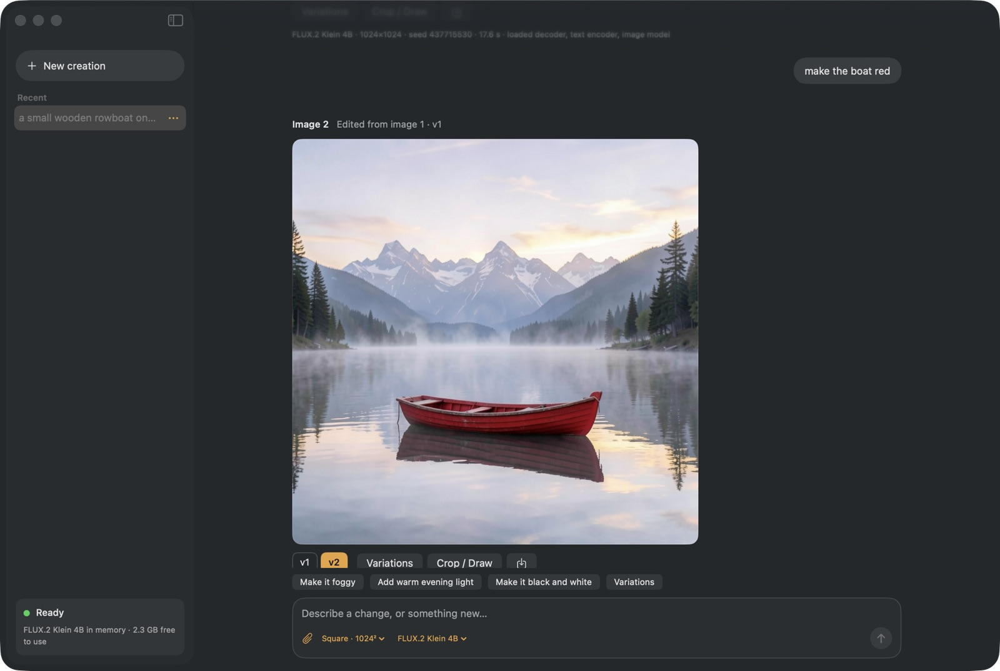
</p>

## Highlights

- **Use chat to make and edit images.** Describe an image. Then write in simple words what to change
  ("make the boat red"). Each image has a number. Thus you can write "image 1" or "the first one".
- **An agent plans each message.** A vision-language model on your Mac reads the chat and examines the
  images. Then it decides: a new image or an edit, the image to change, the images to use as references,
  and the correct image model.
- **The agent replies in the chat.** If a message is not clear, the agent asks one short question. If you
  send a greeting or a question about the app, the agent replies and does not make an image.
- **Your Mac stays available for use.** The engine does a check of the memory before each image job. If
  memory is low, the engine loads models in parts. The engine stops a job before macOS starts to swap.
  dMLX is for Macs with 16 GB of memory or more.
- **Put things where you want them.** With MOSS Image, Ideogram 4 or FIBO 2, the agent plans a layout:
  a box for each part of the image. Move a box, then redraw. The title stays where it was, and the part
  that you moved goes to its new place.
- **The app keeps all versions.** It does not overwrite an image. Variations show as v1, v2, v3. You can
  edit each version. You can also edit your prompt and run it again.
- **Private and offline.** After you download the models, all work occurs on your Mac. You do not need an
  account or a cloud service.
- **A local API.** The engine has an OpenAI-compatible images API for other apps and agents.

## What you can make

Each example is a chat in the app, with **Auto** set. The agent selected the model. For a removal, the
first message makes an image and the second message removes something from it.

### Remove text

"remove all the text from the window" · Qwen Image 2.1 · about 5 min

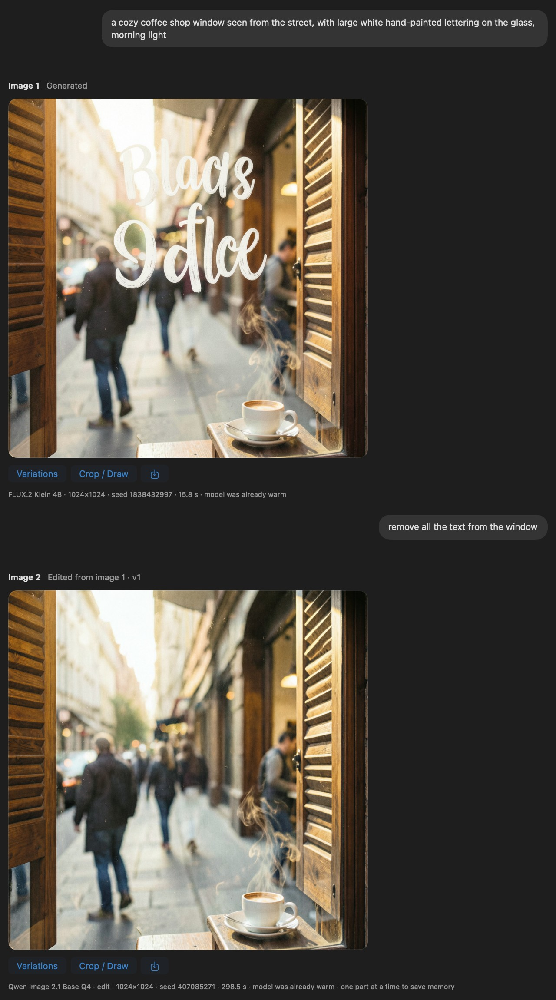

### Remove an object

"remove the coffee mug" · FLUX.2 Klein 4B · 36 s

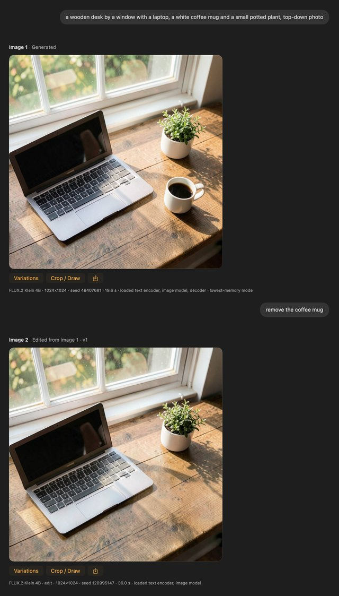

### Remove a person

"remove the person" · FLUX.2 Klein 4B · 40 s


### Make a poster

A Portrait image with a title · Qwen Image 2.1 · about 4 min

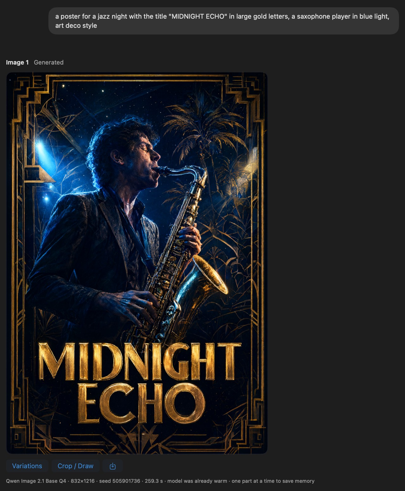

### Make a banner

A Landscape image with words · Qwen Image 2.1 · about 4 min

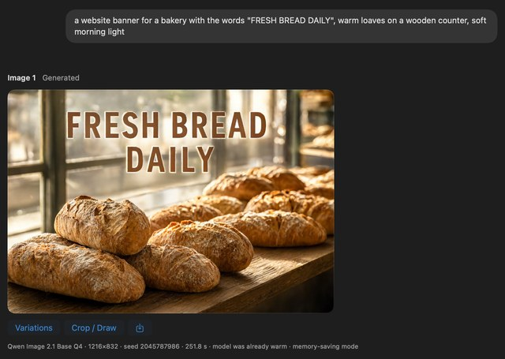

For exact words in an image, the agent usually selects Qwen Image 2.1. This model is slow, it needs about
9.5 GB of free memory, and its license does not permit commercial use. FLUX.2 Klein 4B is fast, but it
does not always spell words correctly.

## Edit with Crop / Draw

You can write in simple words how to change a result. You can also show your request on the image first.
Open **Crop / Draw** below a result. Crop the image. Paint marks on it. Erase the marks that are not correct.
Click **Attach edited image**. Then write what to do. The app does not change the original image.

| 1 · Crop | 2 · Paint a mark | 3 · Erase an incorrect mark |
|---|---|---|
| 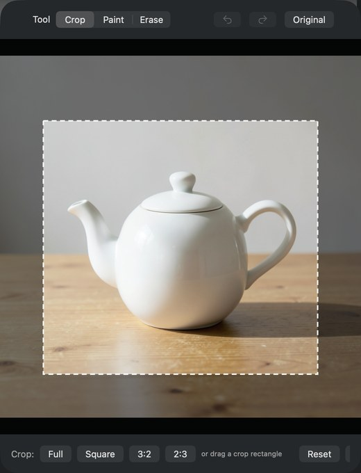 | 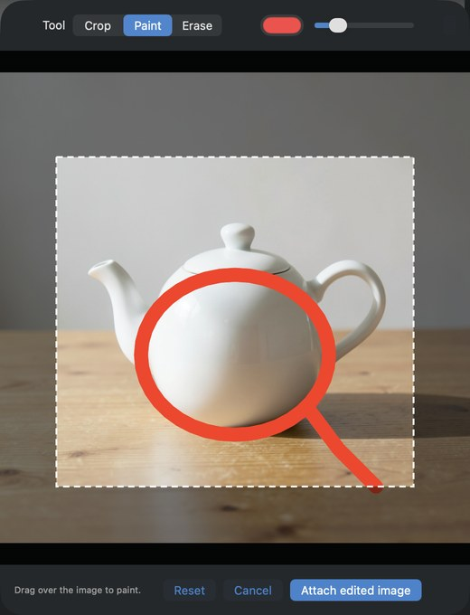 | 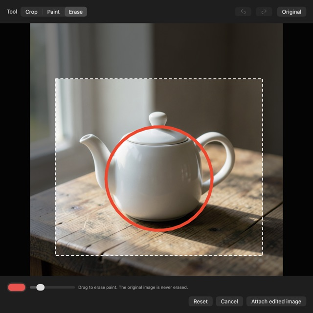 |
| The dimmed area is not in the prepared image. | The circle shows the area to change. The line on the table is an error. The color and brush size are below the image. | Erase removes only paint. The image below the paint does not change. |

**4 · Attach and ask.** **Attach edited image** puts the prepared image in the message box. The agent
gets the prepared image, a note that tells it the image is image 1 after Crop / Draw, and your words.
The marks are part of the prepared image. Write "remove the marks" in your message, or the result can
keep them. The prepared image is one of the 3 images that you can attach.

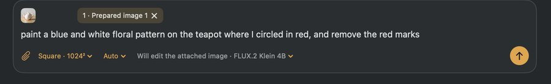

| Before (the prepared image 1) | After (image 2, "Edited from the prepared image 1") |
|---|---|
| 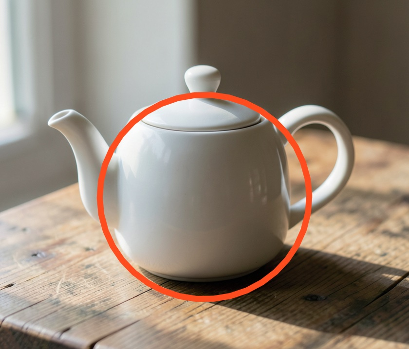 | 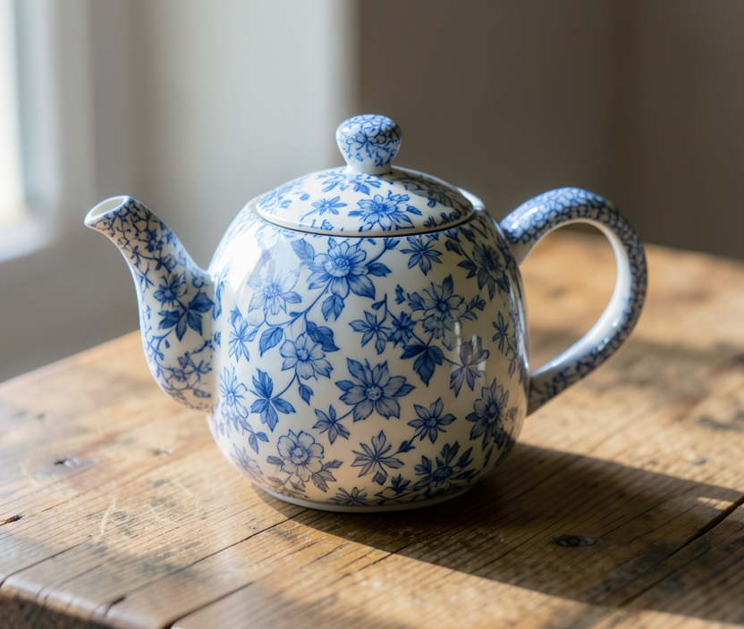 |

The result has the size and the framing of the cropped area, not of the full image 1.

## Place things with Layout

Some image models can put each part of an image in a box. For these models, the agent writes a layout
with the prompt: a box for each title, each line of text and each main object. After the image is done,
the boxes show on it. Click **Hide boxes** to see the image only.

To change the layout, open **Crop / Draw** and select **Layout**. Drag a box to move it, or drag on an
empty area to add a box. The boxes that you move or add turn blue. Click a box to rename it or to
describe it. Then click **Redraw with layout**. The app makes a new version of the image. When you redraw,
every box on the canvas counts as yours, so the agent keeps them where they are. If no box moved, the new version uses
the same seed.


You can also draw a layout before the first image: click **Layout** in the message box, draw the boxes,
and click **Use layout**. The boxes go with your next message. Dashed boxes are for text, and solid boxes
are for objects. For FIBO 2, each box shows the place word that the model gets.

| Draw the boxes on a blank canvas | The layout goes with your next message |
|---|---|
| 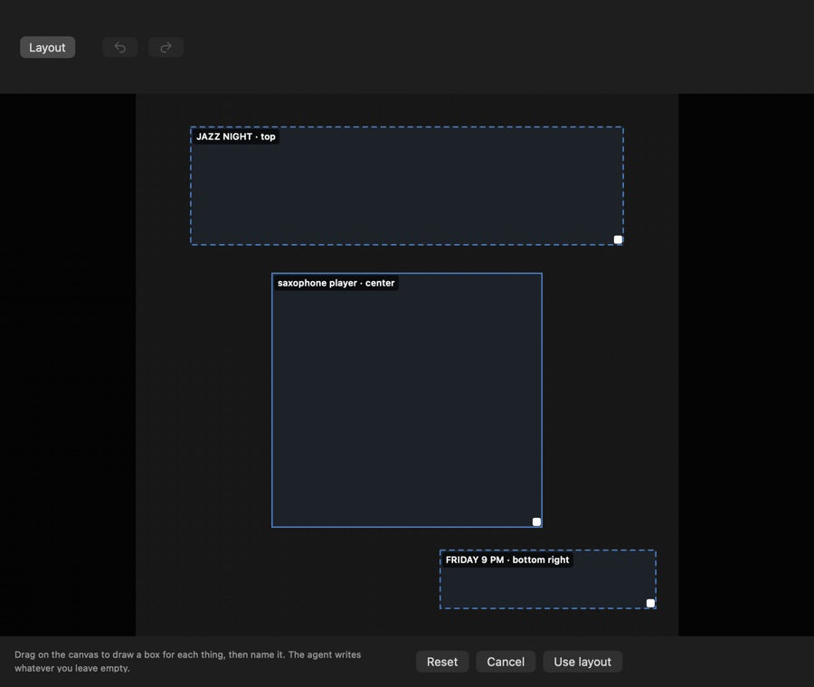 | 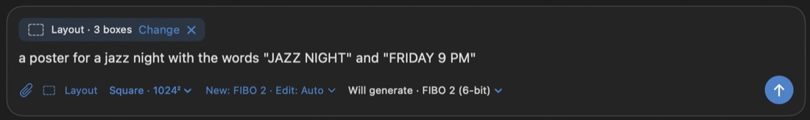 |

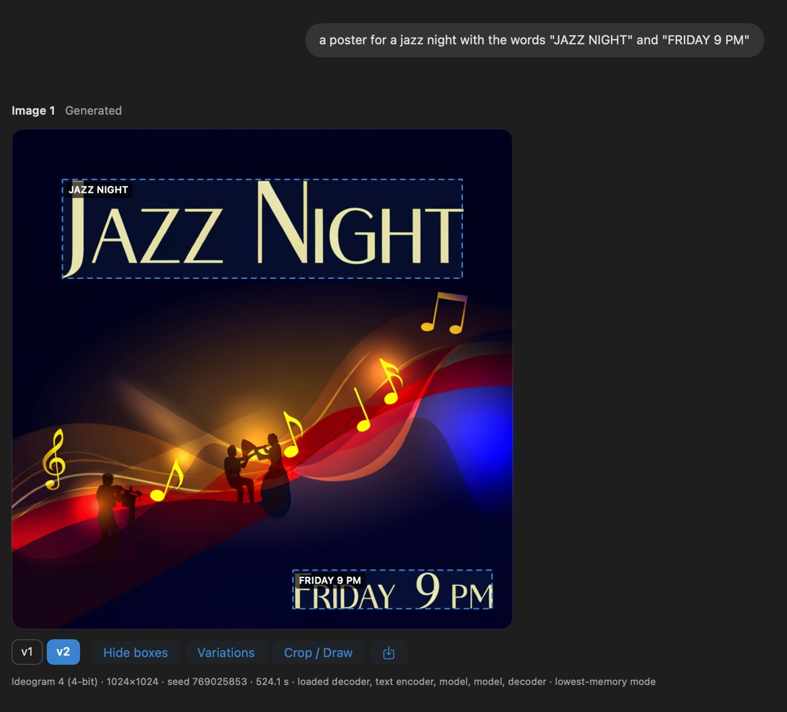

| v1: the agent's layout | v2: FRIDAY 9 PM moved to the bottom right |
|---|---|
|  |  |

| Model | How exact | Time at 1024² on an M5 | License |
|---|---|---|---|
| Ideogram 4 (4-bit, 13.9 GB) | Exact boxes; the best at text | about 8.5 min | non-commercial |
| MOSS Image (4-bit) | Exact boxes | about 5 min | Apache-2.0 |
| FIBO 2 (6-bit, 10.3 GB) | Each box becomes a place word, such as "top center" | about 8 min | non-commercial |

Add these models in **Settings → Models → Add Model…**. The **Layout** button shows when the selected
model can use a layout, or in **Auto** when one of these models is downloaded. In **Auto**, a message with
a layout goes only to these models. FIBO 2
gets no boxes from the agent, only the boxes that you draw. FIBO 2 sometimes adds small text that you did
not ask for.

## Tour of the app

All screenshots show the app on a 24 GB Mac. The agent model is Qwen3-VL 8B.

### The app keeps your message while the agent plans

After you send a message, the chat shows it with "Planning…" while the agent decides. You can type your next message. You can send it when the plan is complete.

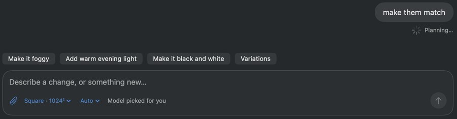

### If the agent is not sure, it asks

With two images in the chat, the message "make them match" gets a question. The agent does not guess. You can answer the question, click **Create new** or **Edit current**, or send a different request.

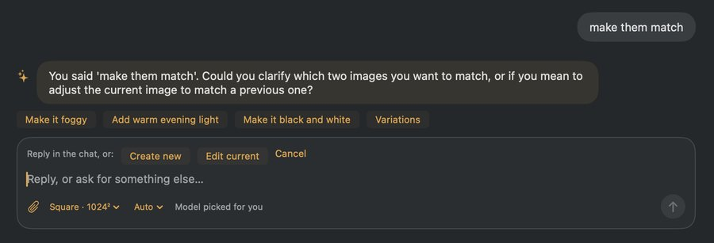

### It can use two images

The message "give the teapot the same weathered wood as the boat" edits the teapot. It uses the boat as a reference ("Edited from image 2 · v1 + 1 reference").

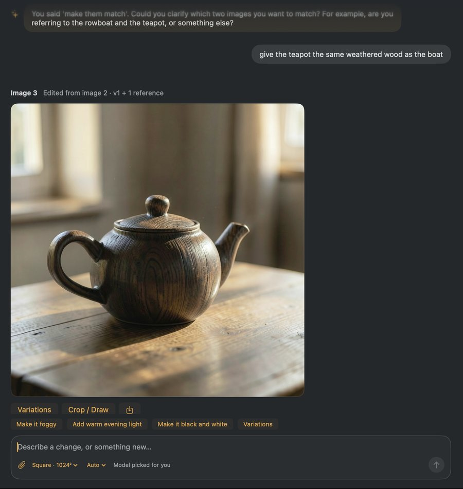

### It finds older images

The teapot is the latest image. The message "make the boat red" edits the boat in image 1. If the message refers to older images, the agent examines them.

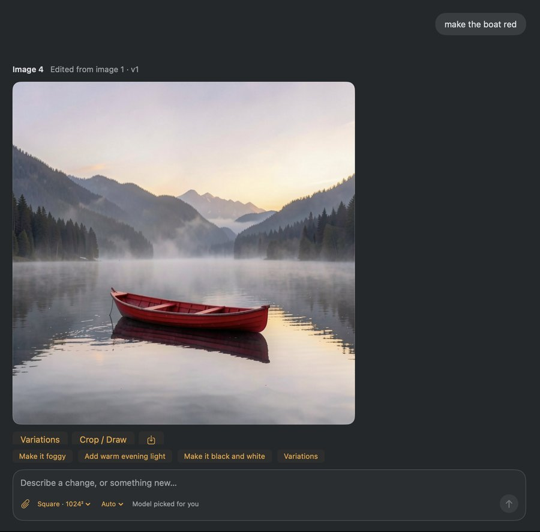

### It replies to casual messages

If you send a greeting or thanks, the agent replies in the chat. It does not make an image.

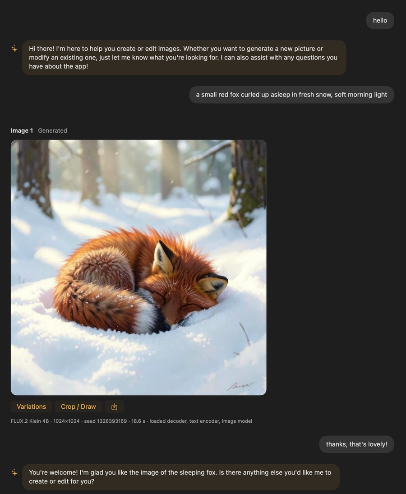

### Use your own images

You can attach a maximum of 3 images with the paper clip or with drag and drop. The message "a lighthouse on a cliff at dusk, painted like this" uses the attached watercolor as the style.

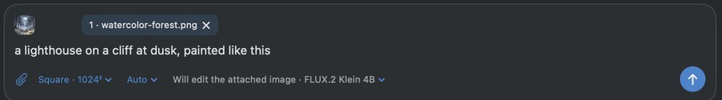<br>
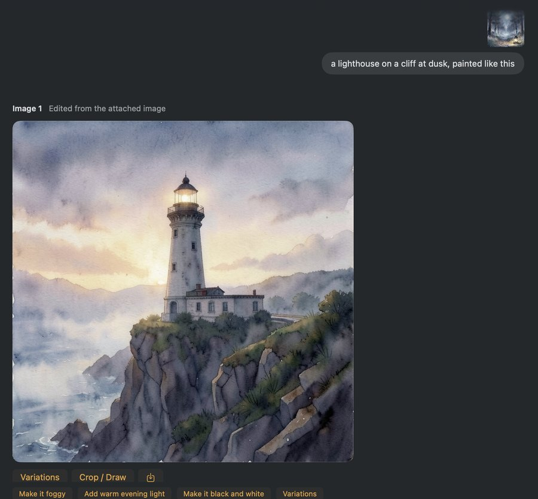

### The app keeps every version

**Variations** adds v2, v3 and more to a result. Click v1 or v2 to show a version. You can edit each version. The save button writes the image to Pictures/dMLX with its prompt and seed.

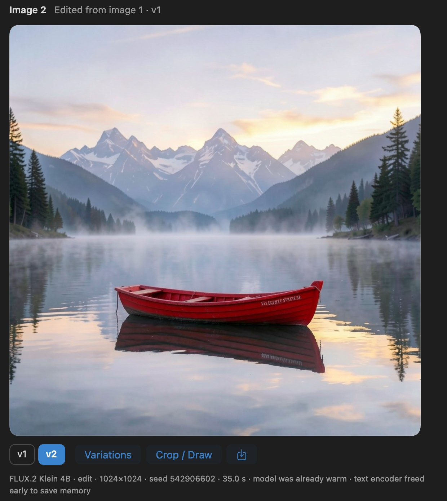

### Auto selects the model, and the engine first does a memory check

For a title in the image, the agent selected Qwen Image 2.1, because this model is the best at text in images. This model needed 9.5 GB, but only 9.2 GB was available without slowing down the Mac. Thus the engine refused the job. **Try anyway** runs the job in the mode that uses the least memory. If the Mac becomes slow, the engine stops the job.

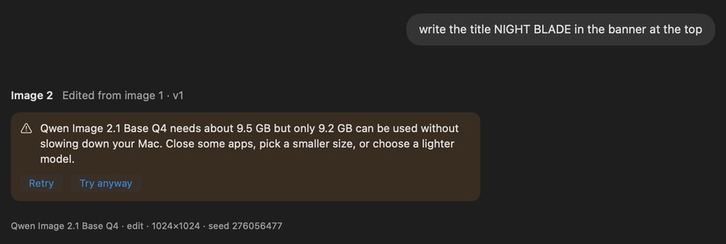

### Add models

Use the search field to find community versions of the supported families. You can also paste a Hugging Face repo. Before the download, dMLX makes sure that it can use the repo. It also shows the download size and the license.

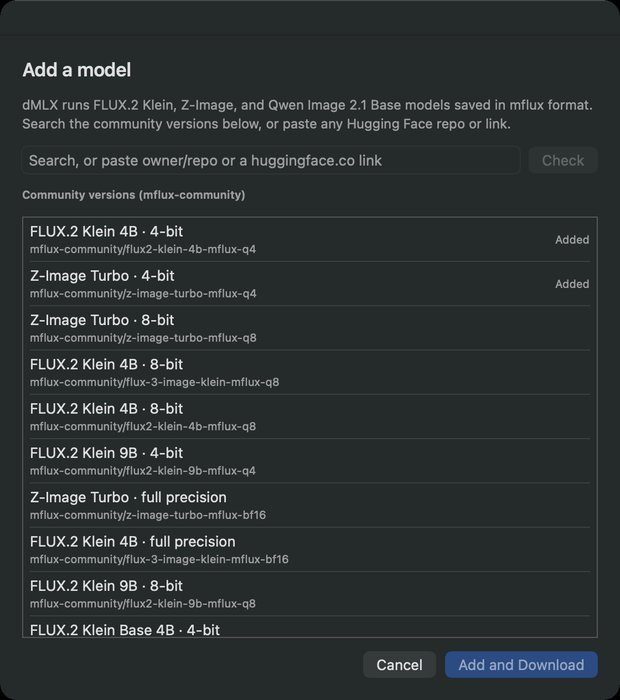

### Control the models

You can see the installed models, remove models, and set the default model. If you set Auto, the agent selects the model.

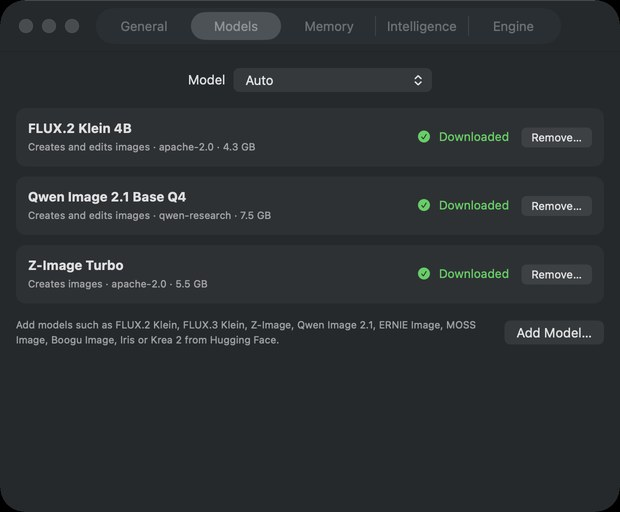

## The agent

The agent plans each message that you send. The agent:

- **decides the type of request**: a new image, an edit, or no image (then the agent replies with text);
- **finds the correct image**: it sees the latest image. If your message refers to older items ("the boat",
  "the one with the cat", "undo the hat"), the agent can *look* at older images or *read* older messages;
- **writes the prompt**: a full description for a new image, or an edit instruction that is complete by
  itself. Optionally, the agent expands the edit instruction into a detailed description of the result.
  Edit models follow such a description better;
- **selects the image model** if the menu is set to **Auto**. It uses the needs of the message (exact words
  in the image, several references) and the free memory. The agent never overrides a model that you select.

If the agent is not sure, it asks one short question. You can answer the question or send a different
request. After you send a message, the chat shows it with **Planning…**. The app never discards the
message. You can continue to type.

**Where the agent runs.** By default the agent runs on your Mac. In the first-run setup, or in **Settings →
Intelligence → Agent**, you can use an AI service that you already have instead:

| Service | What you need | Notes |
|---|---|---|
| Claude (Anthropic) | An API key | Opus 5.5, Sonnet 5.5 or Haiku 5.5. Anthropic charges your account. |
| ChatGPT (OpenAI) | An API key (a ChatGPT subscription is not an API key) | Pick a model from your account's list. OpenAI charges your account. |
| Ollama | Ollama on this Mac | Free. Pick a model that can see images. |
| Other service | Its address, and a key if it needs one | Any service with an OpenAI-compatible API, for example LM Studio or OpenRouter. |

With a service, your messages and the images in the chat go to that service to plan each message. The
images are still made on your Mac. The app keeps the API key in the macOS Keychain; the engine keeps it in
memory only. Before it saves your choice, the app sends one small test request.

The agent makes its decisions from its instructions and tools, not from fixed rules in the code. The code
only refuses a request that cannot run, for example an image that does not exist or an edit with no image.

<p align="center">
  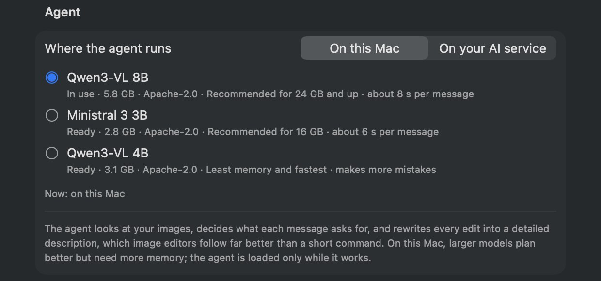
  <br><sub>Settings → Intelligence → Agent</sub>
</p>

| Agent model | Download | Peak memory | Per message | Notes |
|---|---|---|---|---|
| Qwen3-VL 8B | 5.8 GB | 6.2 GB | ~7 s | Default for 24 GB and more |
| Ministral 3 3B | 2.8 GB | 4.2 GB | ~5.5 s | Default for less than 24 GB |
| Qwen3-VL 4B | 3.1 GB | 3.7 GB | ~3.5 s | Uses the least memory; seldom examines older images |

These values are from an M5 with 24 GB (2026-11-01). The engine loads the agent only while the agent plans.
The engine removes the agent from memory before the image job starts. If there is no agent model, the engine
uses simple rules to route messages. For more data, refer to
[`docs/benchmarks/agent-models.md`](docs/benchmarks/agent-models.md) and [`tasks/`](tasks/).

## Requirements

- An Apple Silicon Mac (M1 or newer), with macOS 15 or later
- 16 GB of memory or more
- Disk space: ~5 GB for the default image model, and 2.8–6.0 GB for an agent model

## Install

1. Download `dMLX-<version>-macos-arm64.dmg` from [the dMLX website](https://dmlx.vercel.app/download/) or from
   [GitHub Releases](https://github.com/rootonchair/dmlx/releases), which also has a `.zip` of the same app.
2. Open the `.dmg` and drag `dMLX.app` onto the Applications folder.
3. The beta is not notarized. The first time that you open the app, do this: **right-click the app → Open → Open**.
   As an alternative, run `xattr -dr com.apple.quarantine /Applications/dMLX.app`.
4. When you start dMLX for the first time, it recommends an image model and an agent model for your Mac, and
   shows the total download size. Click **Download**. You can change either model, or skip the agent, and
   change them later in **Settings**. After this step, dMLX operates offline.

## Uninstall

Select **dMLX → Uninstall dMLX…**, or **Settings → General → Uninstall dMLX…**. dMLX shows how much space it
uses, and after you confirm, it deletes all of its models, your chats and images, its settings and its API
keys. Then it moves `dMLX.app` to the Trash. Save the images that you want to keep before you start.

If you drag `dMLX.app` to the Trash, macOS keeps the models and your data. To delete them after that, delete
`~/Library/Application Support/dMLX`. To delete only one model, use **Remove…** in **Settings → Models**.

## How to use dMLX

- **To make an image:** describe it. **To change an image:** write what to change. **To start again:**
  describe a different image.
- **To use an older image:** refer to it in your message ("make image 1 black and white", "put the teapot
  from the first one in the boat").
- **To use your own images:** attach a maximum of 3 images from your Mac with the paper clip. As an
  alternative, drop the images on the message box. A prepared image from Crop / Draw is one of the 3.
- **Variations** adds v2, v3… to a result. **Crop / Draw** crops a result or paints on it, and then attaches
  the prepared image. The save button writes the image to Pictures/dMLX with its prompt and seed.
- **Edit Prompt…** on one of your messages runs the image of that message again with the new words.
- While the app makes an image, the send button changes to **Stop**. You can write your next message during
  this time.
- **Tips:** after the first-run setup, short tips point at the message box, the paper clip, the size menu, the
  new image or edit control, and **New creation**. After your first image, tips explain versions,
  **Variations** and **Crop / Draw**, and the editor explains its tools. To see the tips again, select
  **Help → Show Tips Again**.

## Image models

| Model | Does | License | Download | Notes |
|---|---|---|---|---|
| FLUX.2 Klein 4B (4-bit) | generate, edit, a maximum of 3 images | Apache-2.0 | 4.6 GB | The default; ~20–40 s per image |
| Z-Image Turbo (4-bit) | generate | Apache-2.0 | 5.9 GB | Optional; more photographic detail |
| Qwen Image 2.1 Base (4-bit) | generate, edit, a maximum of 10 images in a set order | Qwen Research License (non-commercial) | ~10.6 GB | Experimental; best for exact words in the image; ~4 min per image; needs ~9.5 GB of free memory |

**Settings → Models → Add Model…** shows community versions of the supported families (FLUX.2 Klein
4B/9B, FLUX.3 Klein, Z-Image Turbo/base, Qwen Image 2.1 Base, ERNIE Image Turbo, MOSS Image, FIBO 2, Ideogram 4, Boogu Image Turbo, Iris 3B Turbo, Krea 2 Turbo). It also
accepts any Hugging Face repo in mflux format. One adapter runs all of these families from mflux's own
model classes, so a new mflux family needs a table entry and a memory measurement
([`docs/benchmarks/families.md`](docs/benchmarks/families.md)).
Before dMLX downloads a repo, it does a check of the family, size and license. If a license has
restrictions, dMLX asks you to accept it. **Remove…** deletes the files of a model. dMLX puts the weights in
its own folder, `~/Library/Application Support/dMLX/models-cache`, in the standard Hugging Face layout, so
**Uninstall dMLX…** can delete all of them. The app bundle never contains weights. When dMLX starts, it moves
its models from the shared Hugging Face cache (`~/.cache/huggingface`) into its own folder. This includes models
from versions before 0.1.0 beta 5, and models that another tool downloaded first. dMLX does not download them
again, but the other tool does if it needs them. In Auto,
the engine uses Qwen Image 2.1 only if the agent selects it for a message.

## How dMLX controls memory

Before each job, the engine calculates the memory that the job needs. The engine compares this value with
the memory that it can use *without* a need for macOS to compress or swap other apps. The engine also
keeps a reserve of memory for the system. Then it selects one of these strategies:

| Strategy | When | What stays loaded |
|---|---|---|
| eager | a large quantity of free memory | all parts; they stay in memory for the next requests |
| phase-free | some free memory | image model and decoder; the engine removes the text encoder after it reads the prompt |
| sequential | low free memory | one large part at a time |
| streamed | very low free memory | one block at a time; the engine reads each block from disk immediately before it runs (~25% slower; a 1024² image in ~1.5 GB) |

On Macs with less than 32 GB, FLUX.2 Klein decodes in exact bands (about 1.1 GB at 1024², not 8.6 GB). If
no strategy fits, the engine refuses the job and shows a clear message. **Try anyway** runs the job in the
mode that uses the least memory. While a job runs, the engine monitors memory pressure and swap-ins. The
engine stops the job before the Mac starts to hang. The engine removes the agent from memory before each
image job. Then the engine waits until that memory is free again. For more data, refer to
[`dmlx-spec.md`](dmlx-spec.md) §8, [`docs/benchmarks/b1.md`](docs/benchmarks/b1.md),
[`b2.md`](docs/benchmarks/b2.md) and [`agent-16gb.md`](docs/benchmarks/agent-16gb.md).

## Build from source

```bash
# engine (Python 3.13, uv)
cd engine && uv sync --extra local-llm && uv run pytest

# app (Swift 6 toolchain / Xcode 16+)
cd app && swift test
tools/dev/run_app.sh            # runs the app; the engine starts from ../engine via uv

# release bundle (relocatable Python and engine inside the .app, ad-hoc signed), as a .dmg and a .zip
tools/bundle_app.sh --dmg --zip
```

To score the agent with the routing eval and placeholder images, run this command:

```bash
cd engine && uv run --extra local-llm python -m dmlx.prompting.agent_eval --model qwen3-vl-8b-instruct-4bit
```

## Engine API

To run the engine without the app, use these commands:

```bash
cd engine && uv run dmlx serve --port 8642
curl -s localhost:8642/v1/images/generations -H 'content-type: application/json' \
  -d '{"prompt":"a rowboat on a lake at dawn","size":"1024x1024"}' | jq '.dmlx'
```

| Method | Path | Notes |
|---|---|---|
| POST | `/v1/images/generations` | OpenAI-compatible; `stream: true` returns server-sent events |
| POST | `/v1/images/edits` | multipart (OpenAI style) or JSON with `source_id` / `reference_ids` |
| POST | `/v1/workflows` | workflow with validation and capability checks; supports streaming |
| POST | `/v1/workflows/route` | what to do with a chat message; `"plan": true` asks the agent |
| GET | `/v1/capabilities` | operations and input limits of each model |
| POST | `/v1/prompts/compile` | prompt enhancement preview |
| POST | `/v1/uploads` | stores an image and gives an id for later references |
| GET | `/v1/results/{id}` · `/meta` | PNG with the prompt and seed in the file · its metadata |
| GET/DELETE | `/v1/jobs/{id}` · `/events` | status · cancel · events |
| POST | `/v1/jobs/{id}/retry` | runs a failed workflow again from the failed step |
| GET | `/v1/models` | catalog with downloaded / loaded state |
| POST | `/admin/models/{id}/pull` · `load` · `unload` | download, pin, free |
| GET | `/admin/memory` | memory budget, pressure, loaded parts |
| GET/POST | `/admin/prompt-assistant` · `/select` · `/pull` | agent models: status, select, download |

Events: `queued`, `plan`, `loading{component}`, `encoding`, `step{step,total}`, `decoding`,
`image{result_id}`, `done{result_ids, report}`, `error{code,message}`, `cancelled`.

### Configuration

The app sets these values in **Settings → Intelligence**. If you use the engine without the app, set
these environment variables.

| Variable | Use |
|---|---|
| `DMLX_PROMPT_ASSISTANT_MODEL` | Agent model id (for example, `ministral-3-3b-instruct-2512-4bit`) |
| `DMLX_PROMPT_ASSISTANT=off` | Sets the agent to off |
| `DMLX_ROUTER_BASE_URL`, `DMLX_ROUTER_MODEL`, `DMLX_ROUTER_API_KEY`, `DMLX_ROUTER_TIMEOUT` | Routes messages without the agent, through any OpenAI-compatible chat server (HTTPS, or HTTP on loopback) |
| `DMLX_ROUTER_PROVIDER=local-llm`, `DMLX_LOCAL_LLM_MODEL_PATH`, `DMLX_LOCAL_LLM_REVISION` | Routes messages without the agent, through a local Qwen checkpoint ("Local Qwen MLX" in the app) |
| `DMLX_PROMPT_BASE_URL`, `DMLX_PROMPT_MODEL`, `DMLX_PROMPT_API_KEY`, `DMLX_PROMPT_TIMEOUT` | Prompt enhancement through an OpenAI-compatible server |
| `DMLX_HOME` | The data folder (default `~/Library/Application Support/dMLX`). The models go in its `models-cache` folder |
| `HF_HUB_CACHE` | If you set it, the engine downloads models to this Hugging Face cache, and does not move models |

If you set API keys in the app, the app keeps them in the macOS Keychain. When the agent plans, the engine
also does a check of its answer. The images that the answer names must exist. An edit must use 1–3 images.
The answer can use only workflows that an installed model can run. If the answer is still not valid after
one retry, the app asks the user and does not guess.

## Project layout

```
engine/   Python engine (FastAPI + MLX via mflux), the planning agent, evals, tests
app/      SwiftUI app (DMLXKit library + app target), tests
tools/    bundle_app.sh (release), dev/ helpers (run_app.sh, the scripted dev harness)
docs/     release notes, known issues, benchmarks, screenshots
tasks/    open and finished agent tasks, with their results
```

## License

All code in this repository uses the Apache-2.0 license. Model weights have their own licenses. The default
models use Apache-2.0. The optional Qwen Image 2.1 uses the Qwen Research License (non-commercial).
