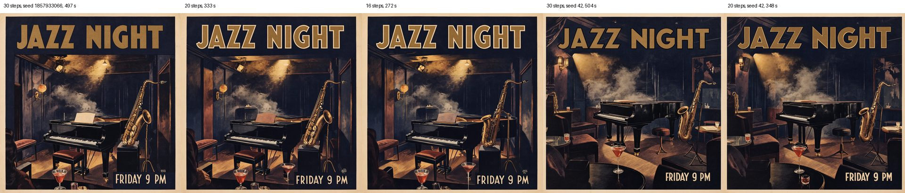

# Task 17 performance: the caption step and step counts

Date: 2026-11-09  
Machine: M5, 24 GB (the dev Mac), other apps open.  
Prompt: the jazz poster from task 17, `a poster for a jazz night with the words "JAZZ NIGHT" and "FRIDAY 9 PM"`.  
Scripts and raw numbers: [raw/task17-perf/](raw/task17-perf/).

## The caption step, per agent

`caption_timing.py` runs the same calls as `Engine._write_caption`: the agent's `structure()` reply, then
`formats.normalize`. One agent per run; the first row of each agent includes loading it. "3 boxes" is a
redraw with the user's boxes (title, date moved to the bottom right, a described saxophonist).

| Agent | load | MOSS layout | FIBO JSON | Ideogram JSON | Ideogram, 3 boxes | valid, first try |
|---|---|---|---|---|---|---|
| Qwen3-VL 8B (default, 24 GB+) | 3.7 s | 7.1 s (6.6 s again) | 14.7 s | 11.5 s | 13.8 s | 5/5 |
| Ministral 3 3B (default, 16 GB) | 3.1 s | 5.6 s (5.6 s again) | 12.3 s | 9.2 s | 10.9 s | 5/5 |
| Qwen3.5 9B (no longer listed) | 3.9 s | 11.3 s (10.7 s again) | 20.4 s | 14.7 s | 18.1 s | 5/5 |

So a new prompt pays 6–20 s for the caption, plus 3–4 s to load the agent when it is not already loaded
(on 24 GB and up it often still is, from planning the message). Every caption passed the check on the
first try, so the retry never ran. Temperature is 0, so a repeat gives the same reply in the same time.
Variations and repeats skip the step (the caption is cached).

## Can the image model load during the caption step? No: there is almost nothing to overlap

What the image model spends loading, from the job report (`timings.load`, the guard's own clock), 1024 px:

| Model | strategy | load | encode | denoise | decode |
|---|---|---|---|---|---|
| FIBO 2, 30 steps | streamed | 0.55 s | 1.5 s | 490 s | 3.1 s |
| Ideogram 4, 20 steps | streamed | 0.44 s | 11.7 s | 515 s | 3.0 s |

On this Mac the planner picks `streamed` for both, and in the low-memory strategies only the parts of the
current phase load, a phase at a time. All loads in a job add up to about half a second, so running them
beside the agent would save at most 0.5 s of a 5–6 minute job. Against that:

- **Memory.** Overlap means the agent (Qwen3-VL 8B: 5.8 GB of weights + 1.5 GB working) and image parts
  resident together. The memory plan (`_plan_memory`) would have to count the agent as well, and on a 16 GB
  Mac it would almost never fit; there the agent already runs only when it has the room alone
  (`docs/benchmarks/agent-16gb.md`).
- **The plan depends on the caption.** The plan skips the text encoder when the caption's embedding is
  cached (`has_embedding(run_request.prompt)`), and that is known only after the caption is written.
- **Two accelerator users at once.** The agent and the image model would run MLX work from two threads.
  Beside a running job the agent was about 3x slower and the image about 1.7x
  (`docs/benchmarks/agent-models.md`), and the worker is built on one model at a time on the accelerator.
- Warming the image model's files in the OS file cache instead (no MLX) does not help either: the load is
  already 0.5 s, and freshly read file pages are not counted as available memory (`sysmem.available`
  counts only inactive file pages), so it would lower the headroom the plan sees.

Not implemented. The step's cost is the agent's own reply; the levers there are a shorter reply (MOSS's
plain captions are the fastest) and keeping the agent loaded from planning to the caption where memory
allows, which 24 GB Macs already do.

## Steps: FIBO 2 and Ideogram 4

`steps_compare.py`: the same caption every run (a fixed agent reply, through `normalize`, the adapter and
the guard), every box the user's, the date moved to the bottom right (the hardest case the app's redraw
sends), 1024 px. The comparison images are in [raw/task17-perf/](raw/task17-perf/) (`docs/benchmarks/raw/`
is ignored by git except this folder, through a `!docs/benchmarks/raw/task17-perf/` rule in `.gitignore`).

| Model | steps | seed | time | denoise | title top | date bottom right | other boxes | lettering |
|---|---|---|---|---|---|---|---|---|
| FIBO 2 | 30 (old default) | 1857933066 | 497 s | 490 s | ✅ | ✅ | ✅ | clean |
| FIBO 2 | **20** | 1857933066 | 333 s | 329 s | ✅ | ✅ | ✅ | clean |
| FIBO 2 | 16 | 1857933066 | 272 s | 268 s | ✅ | ✅ | ✅ | clean; the saxophone drawn less cleanly |
| FIBO 2 | 30 | 42 | 504 s | 497 s | ✅ | ✅ | ✅ | clean |
| FIBO 2 | **20** | 42 | 348 s | 343 s | ✅ | ✅ | ✅ | clean |
| Ideogram 4 | 20 (old default) | 1857933066 | 532 s | 515 s | ✅ | ✅ | ✅ | clean |
| Ideogram 4 | **12** | 1857933066 | 315 s | 312 s | ✅ | ✅ | ✅ | clean |
| Ideogram 4 | 20 | 42 | 514 s | 511 s | ✅ | ✅ | ✅ | clean |
| Ideogram 4 | **12** | 42 | 329 s | 310 s | ✅ | ✅ | ✅ | clean |

**FIBO 2: 20 steps** (was 30), about 5.5 minutes at 1024 px instead of 8. On both seeds the 20-step
poster is the 30-step one with small changes in the details; placement and lettering are the same. 16
steps still placed everything, but the saxophone came out less clean, so 20 keeps a margin.

**Ideogram 4: 12 steps** (its turbo preset; was 20), about 5.4 minutes at 1024 px instead of 8.7 (mean of both seeds). Steps pick
one of three presets (12, 20, 48), so 12 is the only choice below 20. On both seeds the two posters are
nearly the same image: same boxes, same lettering, only small details differ.

(One Ideogram 4 run was first refused with `insufficient_memory`: 6.5 GB needed, 6.3 GB usable while
other apps held memory. That is the planner keeping the 16 GB rules; the retry later ran.)

Saved specs: a spec saved with the old default (FIBO 2 at 30, Ideogram 4 at 20) moves to the new one, and
its old speed note to the new note, as MOSS's 50 → 30 did (`registry._RETIRED_DEFAULTS`,
`_RETIRED_NOTES`). A step count the user set stays. `tests/test_step_defaults.py`.

## In-app checks (DevHarness), 2026-11-09

The real app (`tools/dev/run_app.sh`, `DMLX_HARNESS`), Qwen3-VL 8B agent, 1024 px, a scratch data folder
whose model cache links to the user's models (nothing moved). Flow: "a poster for a jazz night with the words
"JAZZ NIGHT" and "FRIDAY 9 PM"" → Crop / Draw → Layout: move "FRIDAY 9 PM" to the bottom right and describe
it as "hand-painted pink neon script" → Redraw with layout → "make it warmer". Screenshots are in the
scratchpad (`app-ideogram*`, `app-moss`, `app-klein`), not tracked; only the images above are kept.

| Check | Ideogram 4 (12 steps) | MOSS Image (30 steps) |
|---|---|---|
| First poster | ✅ title and date in their boxes; caption 12.1 s; 312 s | ✅ three boxes followed; 292 s |
| Redraw: date moved to the bottom right | ✅ lands there, in the user's pink neon script; title kept | ✅ lands there, in pink neon script; title and band kept |
| "make it warmer", Edit on Auto | ❌ the agent picked Qwen Image 2.1 for the edit, refused: needs 9.5 GB, 7.6 GB usable (nothing of dMLX's was resident: the agent is unloaded before each job and Ideogram's parts were freed) | not checked on Auto (see the note below) |
| "make it warmer", Edit = FLUX.2 Klein 9B | colours warmer, title and date in place, the date still pink neon; Klein painted a face into the empty background; 74 s | ✅ colours warmer, every element in place; the date's pink neon became yellow; 73 s |
| Boxes kept after "make it warmer" | ❌ the edit result has no layout (an edit does not carry the caption or boxes) | ❌ same |

Notes:
- **Agent model choice for the edit (bug, fixed afterwards).** In Auto the agent chose Qwen Image 2.1 Base,
  which cannot fit in the 7.6 GB that were usable, while Klein 4B and 9B would. The planner's refusal is
  right; the choice is the agent's. Fixed afterwards: on Auto a model the plan would refuse is no longer
  offered, or kept, while another one fits (`tests/test_auto_fits.py`; tasks/17, Bugs).
- **Keeping the boxes across a follow-up** needs design 5, "edits keep the caption", which is task 18. A
  follow-up message sends a layout only from the composer, and an edit result has none.
- **A test artefact, not an app bug:** the harness step `modelChoice` sets the model for both New and Edit,
  so the first "make it warmer" in each fresh run had Edit pinned to a model that can't edit; the engine
  then allowed only new images and the agent's edit plan was refused twice ("Should I make a new image, or
  change the current one?"). The app resets that choice on the next launch, which is why the Ideogram
  rerun planned an edit. The Klein runs set Edit explicitly.
- **Stray text on Ideogram 4.** Its posters with only two text boxes and an empty middle twice gained a
  short garbled line ("PNESCHIR SIN" top left; "1GROJJOW GEISIPIL" in the middle on another seed). The
  caption has no such text (two text elements, a short background line), so the model fills empty space
  with lettering. Not caused by the 12-step default: the same caption and seed at 20 steps
  drew a garbled line in the same place ("Tor tat Swy zig.:"). A fuller caption (objects, a described
  background) did not show it in the step runs above.
  Tried afterwards: ending the background with "No other text or lettering anywhere." Same caption and seeds,
  12 steps: the line stays in the same place on both ("STTABIRY SCTILASIM", "HONICK TES TAH"), so it was not
  kept; a known limitation of the model (`raw/task17-perf/stray_text_ab.py`).

  

## Other stored runs

In [raw/task17-perf/](raw/task17-perf/), for task 17's Bugs section: `box_rules.py` / `.log` (box rules
on 36 captions from three agents, before and after), `stop_repro.py` and test round 1's `stop_check*.py` /
`.log` (a stopped job frees its weights), `auto_edit.py` / `.log` and `auto_check.py` / `.log` (Auto offers
only models that fit; the 1024 px edit in 44 s), `auto_default_check.py` / `.log` (an Auto model that won't
fit gives way: Klein 9B passed by hand as the app's Auto model, since the built-in Klein 9B and Qwen Image 2.1
are not auto-selectable and the app's Auto edit model is Klein 4B whenever it is downloaded; the swap matters
for auto-selectable models the user adds, which test round 3 showed in the app with an auto-selectable copy
of Klein 9B), and `user_pick_check.py` / `.log` (a model the user picked is kept and refused, never swapped;
the same message on Auto gets Klein 4B). Local paths in the logs read `<scratch>`; progress bars removed.
